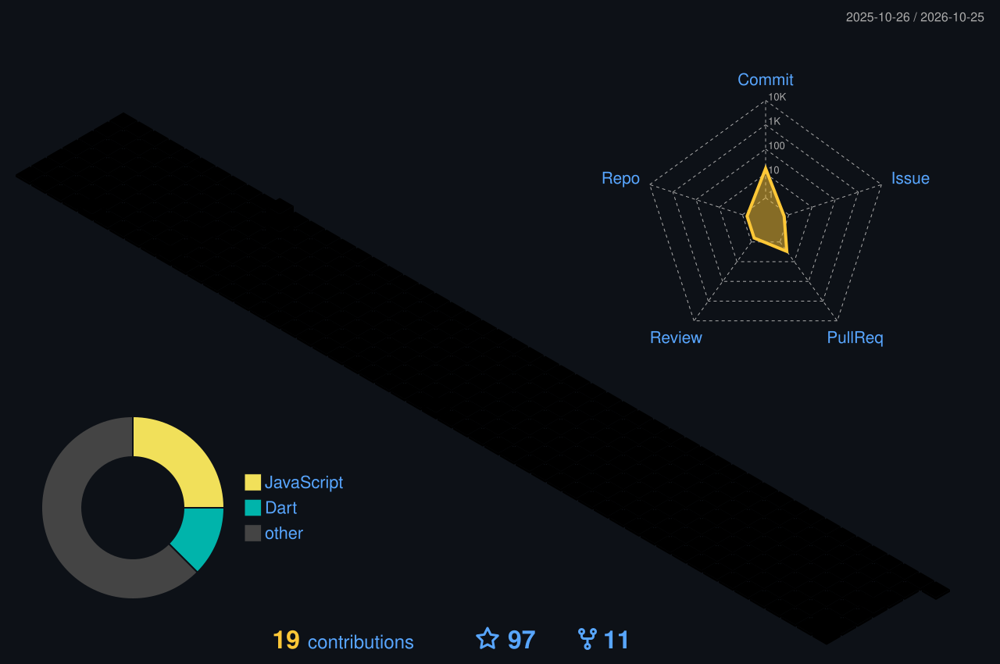

 

 

 
 
 

  <ul align="center">
    
  </ul>

 
<table align="center">
  <tr>
    <td colspan="2" align="center">
      

        <ul align="center">
          <h1 style="display: inline-block">Stats & History</h1>
        </ul>
      

    </td>
  </tr>

  <tr border="none">
    <td width="50%" align="center">       
            
       
     
       
      
             
           
    </td>     
    <td width="50%" align="center">       
            
                   
             
           
    </td> 
  </tr>

  <tr>
    <td colspan="2">
      
    </td>
  </tr>

  <!--<tr align="center">
    <td colspan="2">
      

        <h1 style="display: inline-block">Trophies</h1>
         
        

          
        

      

    </td>
  </tr>-->
</table>

 

  <ul align="center">
    <h1 style="display: inline-block">Tech Stack</h1>
  </ul>

  

### Languages

  
  
  
  
  
  
  
  
  
  

### Backend Development

  
  
  
  

### Cloud & DevOps

  
  
  
  
  
  
  
  
  

### Frontend Development

  
  
  
  
  
  

### Databases

  
  
  
  
  

### AI & Automation

  
  
  

  <ul align="center">
    <h1 style="display: inline-block">Contact</h1>
  </ul>

 
  
  
  

<!-- 

 

 -->

